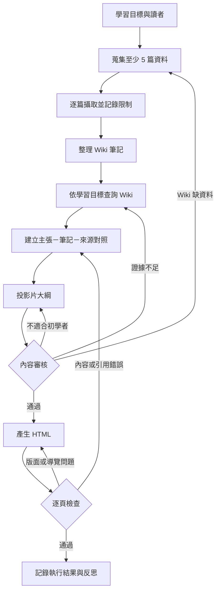

# 作業流程｜以健身 Wiki 製作教學 HTML 簡報

## 作業目標與驗收條件

- **Wiki 主題：** 面向一般運動者的健身與體能訓練。
- **教學題目：** 漸進超負荷入門。
- **讀者：** 原本不熟悉阻力訓練的一般運動者。
- **必備資料量：** 至少 5 篇彼此獨立、與主題相關的資料，且每篇有一筆來源攝取紀錄。參考書目裡有 5 個連結，但沒有來源摘要，不算完成攝取。
- **簡報要求：** 可實際瀏覽的 HTML；初學者能理解定義、常見進階方式、簡單例子與限制；重要主張可追到 Wiki 筆記和資料來源。
- **反思要求：** 只根據本次實際執行記錄，記錄發生過的錯誤與流程調整。

## 工作流程

1. **定義學習目標**：明確寫出讀者、先備知識和學完後能解釋或判斷的內容。目標不清楚時，先回到需求討論。
2. **蒐集資料**：搜尋與問題直接相關的專業指引、綜述或研究。確認至少 5 篇獨立資料，避免以同一篇論文的摘要和新聞報導重複計數。
3. **攝取並登錄**：每篇資料記錄作者／機構、標題、年份、類型、URL、查閱日期、讀取全文或摘要、可支持的主張及限制。摘要未提供的細節標註為未知。
4. **整理 Wiki**：比較來源的研究設計與受試者，將可支持的共同結論和分歧分開寫入主題筆記，避免用單篇短期試驗建立普遍規則。
5. **查詢 Wiki**：以簡報學習目標為查詢條件，從 Wiki 筆記及來源紀錄挑出必要知識。這個專案目前以閱讀 Markdown Wiki 做人工檢索，不宣稱使用向量資料庫或自動 RAG。
6. **建立主張對照**：每個投影片的重要事實記錄「主張 → Wiki 筆記 → 來源 ID」。把有來源支持的研究結論、一般建議和教學設計推論分開標示。
7. **編寫大綱**：由基本概念、進階方式、具體例子、證據限制到重點回顧，逐頁設定一個學習目的。
8. **檢查內容**：核對每個重要主張是否受來源支持、研究限制是否保留、語言是否適合初學者、傷病或健康內容有無越界。
9. **生成 HTML**：依核准大綱製作可瀏覽的投影片，附導覽、來源與 Wiki 回連。
10. **逐頁檢查並修正**：檢查內容、來源、文字可讀性、版面和導覽。任何版面問題回到 HTML 生成；任何無來源主張回到查詢或資料攝取；初學者看不懂則重寫大綱或例子。修正後重新檢查受影響頁面。

## Loop／Graph 設計

## 為什麼這樣設計

- 把來源登錄放在寫 Wiki 和做簡報之前，能及早發現資料數量不足或只有摘要的限制。
- 主張對照讓投影片可追溯，避免生成時把多篇研究的結果合併成一個來源沒有支持的結論。
- 把「證據不足」和「初學者不懂」分流：前者回資料與 Wiki，後者回大綱和說明方式。
- HTML 檢查會回到產生／修改步驟，修正後重新檢查，不以檔案成功寫出當成完成。
- 反思放在實際執行後，避免預先想像錯誤或改寫成看似真實的經驗。

## 本次主張對照

| 投影片主張 | Wiki 筆記 | 來源 |
|---|---|---|
| 漸進超負荷是逐步調整訓練要求，不等於每次加重量 | 漸進超負荷.md | PO-01, PO-02 |
| 增加次數與增加重量都可能是可行方法 | 漸進超負荷.md | PO-03, PO-04 |
| 漸進加重在一項 8 週、年輕女性肘伸展試驗中帶來較大肌肉厚度增幅；固定訓練也有增幅 | 漸進超負荷.md | PO-05 |
| 研究支持漸進式阻力訓練，但不提供人人適用的固定進度表 | 漸進超負荷.md | PO-01, PO-02, PO-03, PO-04, PO-05 |
| 先記錄表現、調整一項變數並保留研究限制 | 漸進超負荷.md | PO-01, PO-03, PO-04 |

## 本次執行紀錄與反思

本次實際執行結果與反思已記錄於 `RUN_LOG.md`；後續每次作業均應在完成後再補寫，不預先編造。

